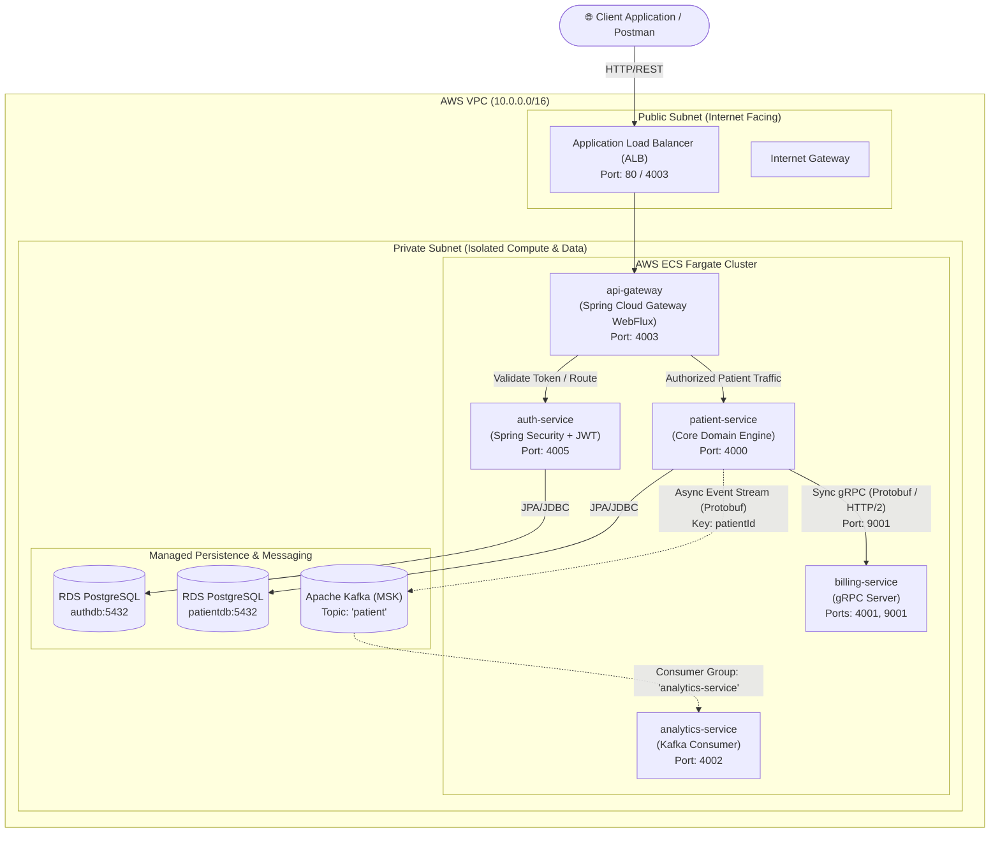
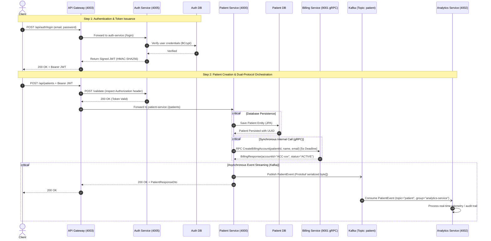

# Enterprise Patient Management System (PMS) 🏥
### Cloud-Native, Event-Driven Microservices Architecture on AWS & LocalStack

[](https://www.oracle.com/java/)
[](https://spring.io/projects/spring-boot)
[](https://aws.amazon.com/cdk/)
[](https://grpc.io/)
[](https://kafka.apache.org/)
[](https://www.postgresql.org/)
[](https://www.docker.com/)
[](https://localstack.cloud/)
[](https://github.com/google/google-java-format)

---

## Executive Summary

The **Enterprise Patient Management System (PMS)** is a production-grade, distributed healthcare backend platform designed to handle patient record management, automated billing account provisioning, secure authentication, and real-time medical event analytics.

Engineered with a **polyglot communication model**, the system couples **Spring Cloud Gateway** for external edge routing, **high-performance gRPC over HTTP/2** for critical synchronous inter-service communication, and **Apache Kafka** for asynchronous, distributed event streaming. The entire cloud infrastructure is defined as **Infrastructure as Code (IaC) using AWS CDK (Cloud Development Kit) in Java**, enabling seamless deployments across both local development environments (**LocalStack Pro**) and production **AWS Cloud** environments (**AWS ECS Fargate, RDS PostgreSQL, MSK, ALB, Cloud Map**).

---

## 🏛️ System Architecture

The infrastructure deploys a high-availability AWS Virtual Private Cloud (VPC) spanning multiple Availability Zones with strict public/private subnet segmentation.



---

## 🔄 End-to-End Request Lifecycle & Communication Flow



---

## 🛠️ Microservices Ecosystem Breakdown

| Service Name | Primary Tech Stack | Exposed Ports | Communication Type | Persistence / Broker | Key Responsibilities |
| :--- | :--- | :--- | :--- | :--- | :--- |
| **`api-gateway`** | Spring Cloud Gateway WebFlux, Netty | `4003` | Non-blocking Reactive HTTP | None (Stateless) | Edge routing, dynamic URI dispatch, centralized non-blocking JWT authentication filter. |
| **`auth-service`** | Spring Boot, Spring Security, JJWT | `4005` | REST / JSON | PostgreSQL (`authdb`) | User registration, password encryption (BCrypt), JWT claims signing & `/validate` endpoint. |
| **`patient-service`** | Spring Boot, Spring Data JPA, Netty-shaded gRPC | `4000` | REST, gRPC Client, Kafka Producer | PostgreSQL (`patientdb`) | Patient domain lifecycle, Jakarta Bean Validation groups, gRPC client with deadlines, Kafka event publishing. |
| **`billing-service`** | Spring Boot, gRPC-Java, Protobuf | `4001` (HTTP), `9001` (gRPC) | gRPC / Protocol Buffers (HTTP/2) | In-Memory / Ledger | High-throughput synchronous billing account provisioning, contract-first schema enforcement. |
| **`analytics-service`**| Spring Boot, Spring Kafka, Protobuf | `4002` (HTTP) | Kafka Consumer Event-Driven | Kafka broker | Asynchronous telemetry, stream listening, Protobuf byte deserialization, audit logging. |
| **`infrastructure`** | AWS CDK v2 (Java 17), CloudFormation | N/A | IaC Constructs | AWS / LocalStack | Defines VPC, Subnets, Route Tables, NAT Gateways, ALB, ECS Fargate, MSK, RDS, and Security Groups. |

---

## 🚀 Key Engineering Highlights (Resume Talking Points)

### 1. Hybrid Inter-Service Communication Strategy
- **North-South Traffic (Client to Gateway):** Traditional HTTP/REST with JSON payloads for maximum client interoperability.
- **Synchronous East-West Traffic (Patient to Billing):** Utilizes **gRPC over HTTP/2** with Protocol Buffers (`billing-service.proto`). Achieves ~7x reduction in payload size compared to JSON and eliminates HTTP handshake overhead via persistent multiplexed TCP channels.
- **Asynchronous East-West Traffic (Patient to Analytics):** Decoupled through **Apache Kafka** using binary Protobuf event serialization (`PatientEvent`). The core patient domain is shielded from analytics latency or downstream consumer downtime.

### 2. Cloud-Native Infrastructure as Code (AWS CDK v2 in Java)
- Developed modular, object-oriented infrastructure constructs using the AWS CDK Java SDK:
  - **[`VpcConstruct`](file:///media/D_Drive/Java/patient-management/infrastructure/src/main/java/com/pm/infra/constructs/VpcConstruct.java):** Multi-AZ VPC with public and private subnets, NAT Gateways, and route table associations.
  - **[`RdsConstruct`](file:///media/D_Drive/Java/patient-management/infrastructure/src/main/java/com/pm/infra/constructs/RdsConstruct.java):** Multi-database RDS PostgreSQL instances configured with dedicated security group ingress from the VPC CIDR block.
  - **[`ServiceConstruct`](file:///media/D_Drive/Java/patient-management/infrastructure/src/main/java/com/pm/infra/constructs/ServiceConstruct.java):** Encapsulated ECS Fargate Task Definitions, CloudWatch Log Groups, Container Definitions, and AWS Cloud Map Service Discovery.
  - **Dual-Target Orchestration:** Parameterized to deploy seamlessly to **AWS Cloud** or local cloud emulation via **LocalStack Pro**.

### 3. Production Resilience & Fault Tolerance
- **gRPC Client Deadlines:** Hardened [`BillingServiceGrpcClient.java`](file:///media/D_Drive/Java/patient-management/patient-service/src/main/java/org/pm/patientservice/grpc/BillingServiceGrpcClient.java) with `.withDeadlineAfter(5, TimeUnit.SECONDS)`. Prevents unbounded thread pool starvation during network degradation.
- **Resource Lifecycle Management:** Configured `@PreDestroy` channel teardown to cleanly terminate socket pools and thread executors on JVM shutdown.
- **Graceful Shutdown:** Configured `server.shutdown=graceful` and `spring.lifecycle.timeout-per-shutdown-phase=20s` across all microservices, ensuring in-flight HTTP and gRPC transactions drain safely before container termination.
- **Resilient Error Envelopes:** Standardized [`GlobalExceptionHandler.java`](file:///media/D_Drive/Java/patient-management/patient-service/src/main/java/org/pm/patientservice/exception/GlobalExceptionHandler.java) across services, capturing gRPC `StatusRuntimeException` and returning meaningful HTTP 503 Service Unavailable envelopes without exposing internal stack traces.

### 4. Code Governance & Automated Formatting
- Configured the **Spotless Maven Plugin** with **Google Java Format (AOSP 4-space style)** across all modules.
- Enforced automated check/apply workflows (`mvn spotless:apply` / `mvn spotless:check`) and root [`.editorconfig`](file:///media/D_Drive/Java/patient-management/.editorconfig) to guarantee uniform indentation, import ordering, and zero whitespace drift across developers.

---

## 📋 Technology Matrix

```
Runtime:           Java 17 (Eclipse Temurin / OpenJDK)
Framework:         Spring Boot 4.0.5 / 3.4.1 (Spring Framework 6.x)
API Gateway:       Spring Cloud Gateway (WebFlux / Reactor Netty)
RPC & IDL:         gRPC 1.69.0, Protocol Buffers v4.29
Event Streaming:   Apache Kafka (Spring-Kafka 4.0.4)
Databases:         PostgreSQL 16, Spring Data JPA / Hibernate
Security:          Spring Security 6, JJWT (io.jsonwebtoken 0.13.0), BCrypt
IaC & Cloud:       AWS CDK v2.257, AWS ECS Fargate, AWS RDS, AWS MSK, AWS ALB
Emulation:         LocalStack Pro (via lstk / docker)
Build Tool:        Apache Maven 3.9+ with multi-module wrappers (mvnw)
Code Quality:      Spotless Maven Plugin (Google Java Format AOSP)
```

---

## 🏃 Local Development & Deployment Guide

### Prerequisites
1. **Docker Desktop** installed and running on Linux/macOS/Windows.
2. **Java 17 JDK** and **Maven 3.9+** installed locally.
3. **LocalStack Pro** CLI (`lstk` or `localstack-aws`) running.

### 1. Build Multi-Stage Docker Images
Each service contains an optimized multi-stage `Dockerfile` with layer caching:

```bash
# Build API Gateway
docker build -t api-gateway:latest ./api-gateway

# Build Auth Service
docker build -t auth-service:latest ./auth-service

# Build Patient Service
docker build -t patient-service:latest ./patient-service

# Build Billing Service
docker build -t billing-service:latest ./billing-service

# Build Analytics Service
docker build -t analytics-service:latest ./analytics-service
```

### 2. Deploy Infrastructure to LocalStack
Run the automated deployment script that builds the CDK project, synthesizes CloudFormation templates, and deploys the stack to LocalStack:

```bash
chmod +x ./infrastructure/localstack-deploy.sh
./infrastructure/localstack-deploy.sh
```

Upon completion, the script outputs the active Application Load Balancer DNS endpoint:
```text
ALB DNS: lb-28a75abf.elb.localhost.localstack.cloud
```

---

## 🧪 Verification & API Walkthrough

### 1. Register a Healthcare Professional
```bash
curl -i -X POST http://localhost:4003/api/auth/register \
  -H "Content-Type: application/json" \
  -d '{
    "email": "doctor@hospital.org",
    "password": "SecurePassword123!",
    "role": "PHYSICIAN"
  }'
```
**Response:** `200 OK`

### 2. Authenticate & Obtain JWT Token
```bash
curl -i -X POST http://localhost:4003/api/auth/login \
  -H "Content-Type: application/json" \
  -d '{
    "email": "doctor@hospital.org",
    "password": "SecurePassword123!"
  }'
```
**Response:**
```json
{
  "token": "eyJhbGciOiJIUzI1NiIsInR5cCI6IkpXVCJ9.eyJzdWIiOiJkb2N0b3JAaG9zcGl0YWwub3JnIi..."
}
```

### 3. Create a Patient (Triggers gRPC Billing & Kafka Event)
```bash
TOKEN="<PASTE_JWT_TOKEN_HERE>"

curl -i -X POST http://localhost:4003/api/patients \
  -H "Authorization: Bearer $TOKEN" \
  -H "Content-Type: application/json" \
  -d '{
    "name": "Jane Doe",
    "email": "jane.doe@example.com",
    "address": "123 Healthcare Ave, Seattle, WA",
    "dateOfBirth": "1990-05-15",
    "dateOfRegister": "2026-10-31"
  }'
```
**Response:**
```json
{
  "id": "e4b2d187-57d4-4a2b-92b0-8c2914109861",
  "name": "Jane Doe",
  "email": "jane.doe@example.com",
  "address": "123 Healthcare Ave, Seattle, WA",
  "dateOfBirth": "1990-05-15",
  "dateOfRegister": "2026-10-31"
}
```

### 4. Verify Asynchronous Telemetry
Inspect the logs of `analytics-service` to verify Kafka message consumption:
```bash
docker logs $(docker ps -qf "name=analytics-service") | tail -n 5
```
**Output:**
```text
[INFO] KafkaConsumerClient: Received event for patientId: e4b2d187-57d4-4a2b-92b0-8c2914109861, eventType: PATIENT_CREATED
```

---

## 📐 Key Design Decisions & Trade-Offs

| Decision | Chosen Technology | Alternatives Considered | Rationale |
| :--- | :--- | :--- | :--- |
| **Inter-Service RPC** | **gRPC / Protobuf** | REST / JSON, OpenFeign | Low serialization overhead, strict contract schemas (`.proto`), and HTTP/2 multiplexing for latency-sensitive financial billing. |
| **Event Streaming** | **Apache Kafka** | RabbitMQ, AWS SQS/SNS | Durable, ordered, high-throughput append-only log with support for event replayability across future analytics workers. |
| **Container Compute**| **AWS ECS Fargate** | Kubernetes (EKS), EC2 | Serverless compute eliminates node patching, OS maintenance, and cluster scaling overhead while integrating natively with VPC and CloudWatch. |
| **Infrastructure** | **AWS CDK (Java)** | Terraform, CloudFormation YAML | Strongly-typed, object-oriented construct composition in the same language as the backend microservices (Java 17). |
| **Code Formatting** | **Spotless (AOSP)** | Checkstyle alone, Manual | Automated formatting directly inside Maven lifecycle; eliminates style debates during code reviews. |

---

## 👤 Author & Maintainer

- **Developer:** Kaushik
- **Repository:** Patient Management System
- **Specialization:** Distributed Systems, Cloud Architecture (AWS), Microservices Engineering
